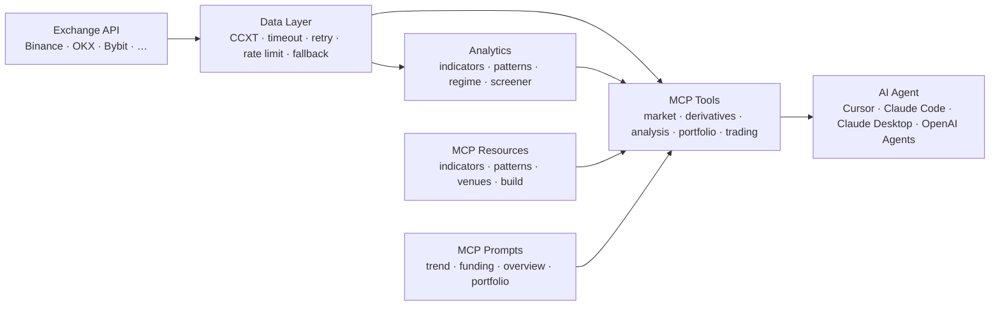

# Crypto MCP Server

[](https://github.com/rosendolu/crypto-mcp-server/actions/workflows/ci.yml)
[](https://github.com/rosendolu/crypto-mcp-server/releases)
[](https://www.python.org/downloads/)
[](https://docs.astral.sh/uv/)
[](https://github.com/astral-sh/ruff)
[](LICENSE)
[](Dockerfile)

**stdio Model Context Protocol server** for cryptocurrency markets: spot and
derivatives data, server-side screening, technical analysis, portfolio and
position inspection, and optional order execution. Built with Python 3.12,
`uv`, FastMCP, CCXT and pandas.

> **Risk disclaimer.** This project is for research and automation-tool
> development. It is **not investment advice**, does not guarantee trading
> outcomes and must not be used as a signal service. You are solely responsible
> for exchange API keys, order placement and market risk.

Changelog: [CHANGELOG.md](CHANGELOG.md) · Tool reference: [docs/tools.md](docs/tools.md)

## Architecture



stdio JSON-RPC only. Logs go to stderr so they never mix with MCP traffic.

## Permission ladder

The server is **read-only by default**, and trading tools are absent from the
tool list unless you opt in.

| Level | How to enable | Adds |
| --- | --- | --- |
| `market` | `PERMISSION_LEVEL=market` | Quotes, candles, order book, fills, funding, funding history, open interest, basis, positioning, venue comparison |
| `analysis` | **default** | Market + indicators, multi-timeframe analysis, candlestick patterns, market regime, screener |
| `portfolio` | `PERMISSION_LEVEL=portfolio` or `ENABLE_PORTFOLIO=true` | Analysis + balances, orders, portfolio, positions |
| `trading` | `PERMISSION_LEVEL=trading` or `ENABLE_TRADING=true` | Portfolio + place/cancel orders |

`ENABLE_TRADING=true` always selects trading, even if `PERMISSION_LEVEL` is
lower. Use a dedicated API key with no withdrawal permission.

## Tools

24 tools across four levels. Full parameter tables: [docs/tools.md](docs/tools.md).

**Market data**

| Tool | Level | What it answers |
| --- | --- | --- |
| `get_ticker` | market | Latest quote for one pair |
| `get_candles` | market | OHLCV candles, 15 supported intervals |
| `get_order_book` | market | Bid/ask levels |
| `get_recent_trades` | market | Most recent public fills |
| `compare_markets` | market | Spread for `last`, `bid`, `ask` or `funding_rate` across venues |

**Derivatives intelligence**

| Tool | Level | What it answers |
| --- | --- | --- |
| `get_funding_rate` | market | Current funding, next funding time, predicted rate |
| `get_funding_history` | market | Is this funding normal? Includes average, min/max and annualized carry |
| `get_open_interest` | market | Current open interest or its history |
| `get_basis` | market | Spot versus perpetual basis plus funding carry, read from one venue |
| `get_long_short_ratio` | market | Long/short account ratio history |

**Analysis**

| Tool | Level | What it answers |
| --- | --- | --- |
| `analyze_indicators` | analysis | 27 indicators with aliases, per-interval or with `tail` history |
| `get_multi_timeframe_analysis` | analysis | Are the timeframes telling the same story? Per-timeframe bias + consensus |
| `detect_patterns` | analysis | 9 candlestick patterns, with `bars_ago` for older occurrences |
| `get_market_regime` | analysis | Trending or ranging, volatility expanding or compressed, plus the evidence |
| `scan_market` | analysis | Filter and rank a venue: volume, movers, extreme funding, tightest spreads |

**Portfolio and execution**

| Tool | Level | What it answers |
| --- | --- | --- |
| `get_balance` | portfolio | Non-zero balances on one venue |
| `get_orders` | portfolio | Open orders, history, one order, or fills |
| `get_portfolio` | portfolio | Per-venue and combined balances |
| `get_positions` | portfolio | Open positions with leverage, liquidation price and unrealized PnL |
| `place_order` / `cancel_order` | trading | Order execution, opt-in only |

**Discovery**

| Tool | Level | What it answers |
| --- | --- | --- |
| `list_exchanges` | market | Which venues support what, and which have credentials |
| `get_capabilities` | market | Active level, size caps, resources, prompts |
| `get_server_info` | market | Version, transport and dependency versions |

### Size caps

Every list response is bounded and says when a cap was hit:

```json
{ "truncated": true, "limits": { "limit": { "requested": 10000, "applied": 1000, "cap": 1000 } } }
```

Candles 1000 · order-book levels 50 · fills 200 · funding/OI/positioning points
200 · screener rows 100 · orders 500 · indicator tail 50 · timeframes 4. A limit
below 1, or an unsupported interval, is rejected with `INVALID_ARGUMENT`.

### Usage examples

```json
{ "symbol": "BTC/USDT", "exchange": "binance" }
```

```json
{ "symbol": "BTC/USDT", "exchanges": ["binance", "okx"], "field": "funding_rate" }
```

```json
{ "exchange": "binance", "quote": "USDT", "sort_by": "abs_funding_rate", "limit": 10 }
```

```json
{ "symbol": "BTC/USDT", "timeframes": ["15m", "1h", "4h"], "indicators": ["ema", "rsi", "adx"] }
```

Unified errors look like `{ "error": { "code": "TIMEOUT", "message": "..." } }`.
`NOT_SUPPORTED` means the venue does not publish that capability; when no venue
in the fallback chain does, the per-venue attempts come back in `details`.

## Resources and prompts

| URI | Contents |
| --- | --- |
| `crypto://indicators` | Indicator catalogue: category, parameters, aliases |
| `crypto://patterns` | Candlestick patterns with their direction |
| `crypto://exchanges` | Featured venues with capability matrix and credentials |
| `crypto://server-info` | Version, transport and dependency versions |

| Prompt | Returns |
| --- | --- |
| `analyze_trend` | Regime → multi-timeframe → indicators → patterns workflow |
| `funding_arbitrage_check` | Basis, funding history, cross-venue dispersion, open interest |
| `market_overview` | Screener workflow for one venue |
| `portfolio_review` | Balances, positions and open orders (portfolio level) |

## Reliability

Public calls retry transient failures (`EXCHANGE_RETRY_ATTEMPTS`,
`EXCHANGE_RETRY_BACKOFF_MS`), space requests (`EXCHANGE_MIN_INTERVAL_MS` plus
CCXT `enableRateLimit`), and may fail over to `EXCHANGE_FALLBACKS`. Cross-venue
queries and multi-timeframe analysis run concurrently, and one failing venue is
reported in place instead of failing the whole answer. Portfolio and trading
calls never fail over.

If exchange APIs are only reachable through a proxy, set `CRYPTO_MCP_PROXY`
(e.g. `http://127.0.0.1:7890`). CCXT's async client does not read `HTTPS_PROXY`
on its own, so the server applies it explicitly; the conventional
`HTTPS_PROXY` / `HTTP_PROXY` variables are used when `CRYPTO_MCP_PROXY` is empty.

## Quick start

```bash
uv sync
cp .env.example .env
uv run crypto-mcp-server
```

Public market data does not need credentials. Portfolio tools need
`<EXCHANGE_ID>_API_KEY` and `<EXCHANGE_ID>_SECRET`.

```dotenv
DEFAULT_EXCHANGE=binance
PERMISSION_LEVEL=analysis
ENABLE_TRADING=false
EXCHANGE_TIMEOUT_MS=30000
EXCHANGE_RETRY_ATTEMPTS=3
EXCHANGE_FALLBACKS=okx,bybit
```

## Client configuration

The same stdio command works for every client. Ready-made files live in
`examples/`. Details: [docs/clients.md](docs/clients.md).

**Cursor** — `.cursor/mcp.json` (see `examples/cursor.mcp.json`):

```json
{
  "mcpServers": {
    "crypto-mcp-server": {
      "command": "uv",
      "args": ["run", "--directory", "/absolute/path/to/crypto-mcp-server", "crypto-mcp-server"],
      "env": {
        "DEFAULT_EXCHANGE": "binance",
        "PERMISSION_LEVEL": "analysis",
        "ENABLE_TRADING": "false"
      }
    }
  }
}
```

**Claude Desktop** —
`~/Library/Application Support/Claude/claude_desktop_config.json`
(`examples/claude-desktop.json`).

**Claude Code** — project `.mcp.json` or:

```bash
claude mcp add crypto-mcp-server -- uv run --directory /absolute/path/to/crypto-mcp-server crypto-mcp-server
```

**OpenAI Agents SDK** — `examples/openai_agents.py` (`MCPServerStdio` with the
same `uv` command).

**Docker**

```bash
docker build -t crypto-mcp-server .
docker run -i --rm --env-file .env crypto-mcp-server
```

## Demos

Walkthroughs against recorded fixtures (no live API): [docs/demos.md](docs/demos.md).

| Prompt | Tool |
| --- | --- |
| Analyze BTC's recent 4h trend | `analyze_indicators` |
| Compare the Binance and OKX spread | `compare_markets` |
| Which perps have the most extreme funding? | `scan_market` with `sort_by=abs_funding_rate` |
| Is BTC/USDT trading above spot? | `get_basis` |
| Show my multi-exchange asset distribution | `get_portfolio` (portfolio level) |

## Indicators and patterns

`analyze_indicators` supports 27 indicators across trend, momentum, volatility
and volume: SMA/EMA, MACD, RSI, Bollinger Bands, KDJ, ATR, ADX/DMI, Ichimoku
Cloud, Keltner Channels, KST, MFI, OBV, PSAR, ROC, Stochastic, Stochastic RSI,
TRIX, VWAP, Williams %R, CMF, CCI, Force Index, Awesome Oscillator, Chandelier
Exit, ADL and volume spikes. Common aliases are accepted.

`detect_patterns` supports 9 candlestick patterns: doji, hammer, shooting star,
bullish and bearish engulfing, three white soldiers, three black crows, morning
star and evening star.

Both catalogues are exposed as resources (`crypto://indicators`,
`crypto://patterns`) so an agent can read them instead of guessing.

## Exchange configuration

Any id in `ccxt.exchanges` can be passed as `exchange`. Resolution order:

1. Explicit `exchange` argument
2. `DEFAULT_EXCHANGE`
3. First exchange with credentials
4. `binance` for public data

Contract symbols use CCXT notation (`BTC/USDT:USDT`). Derivative tools derive
that symbol from the pair, and `get_positions` accepts either form.

## Development

```bash
uv sync
uv run ruff check .   # blocking in CI
uv run pytest         # no live exchange calls
```

Tests use `tests/fixtures/` recorded tickers, candles, books, funding, open
interest, positioning, positions and balances. `tests/test_stdio_e2e.py`
additionally spawns the real stdio entrypoint and performs an MCP handshake, and
`tests/test_contracts.py` keeps the tool surface, its documentation and its size
caps in sync.

```text
src/            FastMCP server, CCXT layer, analytics, tools, resources
src/tools/      market · derivatives · analysis · screener · account · trading
tests/fixtures  Recorded market snapshots
examples/       Cursor / Claude / OpenAI agent configs
docs/           Tool reference, product plan, demos, client setup
```

## License

Apache License 2.0.
